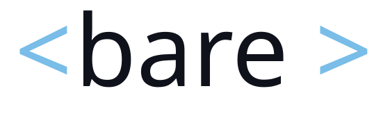

# BareEditClj

  <picture>
    <source media="(prefers-color-scheme: dark)" srcset="docs/assets/baredom_darkmode.svg">
    <source media="(prefers-color-scheme: light)" srcset="docs/assets/baredom_lightmode.svg">
    
  </picture>

A small, local, browser-based editor for Clojure and ClojureScript. Run `bare-edit` in a project folder and it opens an editor for that folder.

## Development

| Task | Command |
|---|---|
| Run the server and shared tests (bb) | `bb test` |
| Run the shared and browser tests in ClojureScript (Node) | `bb cljs-test` |
| Build the browser bundle | `bb build` |
| Lint | `clj-kondo --lint src test dev` |
| Check every docstring against `.claude/rules/docstrings.md` (exits 1 on a problem, for CI) | `bb docstrings` |
| Start the editor for the current folder | `bb --config <path>/bb.edn start` (add `--no-open` to skip the browser) |

## Layout

| Folder | What lives there |
|---|---|
| `src/shared` | The protocol as data, used by the server and the browser |
| `src/server` | The bb server: HTTP, WebSocket, and the security checks |
| `src/app` | The browser app (ClojureScript, shadow-cljs) |
| `dev` | Development tools that do not ship, such as the docstring checker |
| `test` | Table tests for the pure functions, the event steps, and server tests over a real WebSocket |
| `.claude/rules` | Rules for Claude Code, such as how docstrings are written |

## License

MIT, see [LICENSE](LICENSE). The dependencies keep their own licenses: CodeMirror, Lezer and BareDOM are MIT, `@nextjournal/lezer-clojure` is ISC, clojure-mode is EPL-2.0, ClojureScript and shadow-cljs are EPL-1.0, and the Google Closure Library is Apache-2.0.
