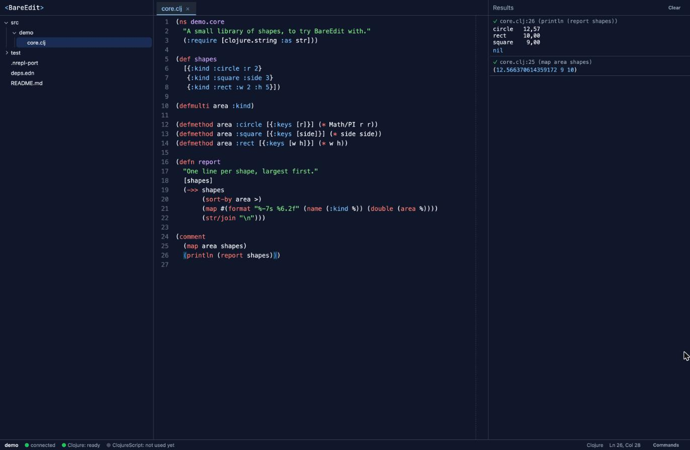

<p align="center">
  <picture>
    <source media="(prefers-color-scheme: dark)" srcset="docs/assets/bareedit_darkmode.svg">
    <source media="(prefers-color-scheme: light)" srcset="docs/assets/bareedit_lightmode.svg">
    
  </picture>
</p>

A small, local, browser-based editor for Clojure and ClojureScript, with a file tree, a command palette, structural editing and evaluation through your project's own REPL. It also edits Markdown, HTML, CSS, JSON and JavaScript, and any other file as plain text.



**Status:** early and in daily use, tested on macOS. It runs on your machine only, for one user. Changes are listed in [CHANGELOG.md](CHANGELOG.md).

**Read-Only Demo**: [Github Pages](https://avanelsas.github.io/bareedit/)

## Requirements

- [Babashka](https://babashka.org), [bbin](https://github.com/babashka/bbin) and Java. Babashka uses Java to fetch the editor from Clojars the first time it runs.
- To evaluate code: an nREPL in your project for Clojure, or shadow-cljs for ClojureScript.

## Install

```sh
bbin install com.github.avanelsas/bareedit --mvn/version 0.2.0
```

This adds the `bareedit` command. To upgrade, run it again with the new version. To remove it, run `bbin uninstall bareedit`.

## Start

```sh
cd my-project
bareedit                 # opens the editor for this folder
bareedit ../other        # or for another folder
bareedit --build app     # when several shadow-cljs builds run
bareedit --help          # the options, and --version for the version
```

The editor opens in your browser and reaches only that folder. Closing the browser tab stops it a few seconds later. A reload keeps it running.

## Keys

`Mod` is Cmd on macOS and Ctrl elsewhere. `Mod-Shift-p` or `F1` opens the command palette, which lists every command with its keys. The default keys are in [docs/usage.md](docs/usage.md#keys).

## Connect a REPL

**Clojure.** Start an nREPL in the project folder, before or after the editor. BareEdit finds it through `.nrepl-port` and reconnects when it restarts.

```sh
clojure -Sdeps '{:deps {nrepl/nrepl {:mvn/version "1.7.0"}}}' \
  -J-Djdk.attach.allowAttachSelf -M -m nrepl.cmdline
```

The `-J` flag lets Interrupt stop running code on Java 20 and later.

**ClojureScript.** Start a shadow-cljs watch and open your app, so a JavaScript runtime connects:

```sh
npx shadow-cljs watch app
```

Code is evaluated in its file's namespace. When that namespace is not loaded yet, run **Evaluate file** from the palette first. More on evaluation, completion and ClojureScript is in [docs/usage.md](docs/usage.md).

## Settings

Run **Open settings** from the command palette. It opens `~/.config/bareedit/config.edn`, which lists every setting with its default as a comment. Saving applies it at once. What each setting does is in [docs/usage.md](docs/usage.md#settings).

## Development

To build BareEdit from a clone or work on it, see [docs/development.md](docs/development.md).

## License

MIT, see [LICENSE](LICENSE). The dependencies keep their own licenses: CodeMirror, Lezer and BareDOM are MIT, `@nextjournal/lezer-clojure` is ISC, clojure-mode is EPL-2.0, ClojureScript and shadow-cljs are EPL-1.0, and the Google Closure Library is Apache-2.0.
